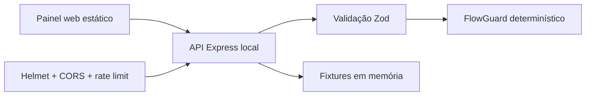

# Chatbot Jurídico Electron


Demonstração pública e sanitizada da arquitetura de um chatbot jurídico com
painel web. O repositório preserva a proposta visual e alguns padrões de fluxo,
mas foi reconstruído para **não conter operação real, dados pessoais, documentos,
credenciais, sessões, chaves de API ou regras internas completas**.


> **Importante:** este projeto é um showcase técnico. Ele não presta orientação
> jurídica, não atende clientes e não deve ser usado em produção.

## O que está incluído

- painel estático responsivo com dados 100% fictícios;
- backend Express limitado a rotas demonstrativas;
- simulador de conversa determinístico, sem IA e sem WhatsApp;
- `FlowGuard` reduzido para proteger transições ambíguas;
- validação estrita de entrada com Zod;
- cabeçalhos HTTP seguros com Helmet;
- CORS por lista de origens e limitação de requisições;
- testes de API e regressões do fluxo com `node:test`;
- scanner local de arquivos sensíveis e padrões de segredo;
- CI, CodeQL e Dependabot para manutenção no GitHub.

## O que foi deliberadamente removido

Esta edição pública **não contém**:

- sessão ou automação do WhatsApp;
- consultas reais ao PJe ou a outros tribunais;
- acesso ao Supabase ou qualquer banco de produção;
- integração com serviços de assinatura eletrônica;
- chaves de IA, prompts operacionais ou chamadas a modelos;
- documentos de clientes, logs, telefones, e-mails ou identificadores reais;
- executáveis Electron, caches, bancos locais ou `node_modules`;
- o fluxo completo e as regras proprietárias do sistema privado.

## Demonstração do FlowGuard

O fluxo público contém apenas regras mínimas e testáveis. Por exemplo, mencionar
“laudos”, “CNIS” ou “documentos” durante um relato não inicia o envio de arquivo.
O upload demonstrativo só é liberado por um comando explícito.

Exemplos protegidos:

| Contexto        | Mensagem                            | Resultado                                 |
| --------------- | ----------------------------------- | ----------------------------------------- |
| Relato jurídico | “Tenho laudos e CNIS para analisar” | mantém o relato; não inicia upload        |
| Menu principal  | “Quero enviar documentos”           | abre o modo demonstrativo de anexo        |
| Fora de um menu | “2”                                 | não interpreta o número como opção global |
| Agendamento     | “Qualquer dia na próxima semana”    | preserva o contexto da agenda             |

## Arquitetura



Mais detalhes estão em [docs/architecture.md](docs/architecture.md).

## Executar localmente

Requisitos:

- Node.js 20.19 ou superior;
- npm 11 ou compatível.

```bash
git clone https://github.com/jvalvim-bit/chatbot-juridico-electron.git
cd chatbot-juridico-electron
npm ci --ignore-scripts
copy .env.example .env
npm start
```

No Linux ou macOS, use `cp .env.example .env`. Depois, acesse
`http://127.0.0.1:3000`.

O arquivo `.env.example` contém somente nomes de variáveis e valores locais de
exemplo. Integrações externas permanecem vazias e não são necessárias para a
demonstração.

## Comandos úteis

```bash
npm start                 # inicia o painel local
npm run dev               # reinicia o servidor durante alterações
npm test                  # executa regressões de API e fluxo
npm run lint              # analisa a qualidade do JavaScript
npm run format:check      # verifica a formatação
npm run security:secrets  # procura segredos e artefatos proibidos
npm run security:audit    # audita dependências com severidade alta ou maior
npm run check             # executa toda a validação acima
```

## Controles de segurança

O projeto aplica defesa em profundidade compatível com o escopo de demonstração:

1. dependências fixadas e `package-lock.json` versionado;
2. instalação do CI com `npm ci --ignore-scripts`;
3. CSP e demais cabeçalhos enviados pelo Helmet;
4. servidor vinculado somente a `127.0.0.1` por padrão;
5. CORS limitado às origens configuradas;
6. corpo JSON limitado a 16 KB e validado por esquema estrito;
7. rate limit global e limite adicional no simulador;
8. respostas de erro sem detalhes internos;
9. `.gitignore` cobrindo chaves, sessões, documentos, bancos e builds;
10. scanner de segredos executado localmente e no CI;
11. CodeQL semanal e Dependabot para npm e GitHub Actions.

### Se uma integração privada for adicionada

Segredos devem existir apenas no ambiente do backend. No Supabase, chaves
privilegiadas nunca podem ser expostas ao navegador, e tabelas acessíveis pela
Data API devem usar RLS com políticas de autorização por proprietário. Uploads
precisam validar tipo, tamanho, nome e conteúdo; webhooks precisam verificar
assinatura e replay.

## Estrutura

```text
.
├── .github/               # CI, CodeQL e Dependabot
├── docs/                  # documentação da arquitetura
├── public/                # painel web e ativos visuais
├── scripts/               # verificador de segredos
├── src/
│   ├── bot/               # engine determinística de demonstração
│   ├── flow/              # regras reduzidas do FlowGuard
│   ├── security/          # validação da configuração local
│   ├── app.js             # aplicação Express
│   ├── mock-data.js       # única fonte dos dados exibidos
│   └── server.js          # inicialização em loopback
└── test/                  # testes HTTP e de transições
```

## Privacidade e responsabilidade

Todos os nomes, métricas, horários e identificadores exibidos são fictícios. Não
use dados pessoais, documentos jurídicos ou credenciais ao testar o simulador.
Consulte [SECURITY.md](SECURITY.md) para reportar uma vulnerabilidade.

## Licença

Todos os direitos reservados. Este repositório é publicado para demonstração e
não concede permissão automática de cópia, modificação, distribuição ou uso
comercial. Veja [LICENSE](LICENSE).
