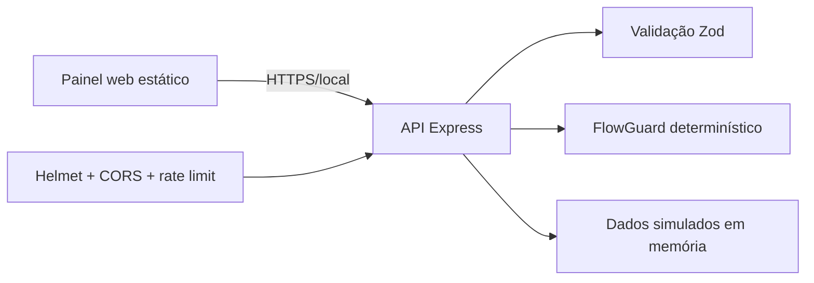

# Arquitetura da demonstração

Esta edição pública implementa apenas uma fatia segura e reproduzível da ideia do
produto. Ela não contém o runtime Electron, sessão do WhatsApp, consultas PJe,
assinatura digital, documentos, banco de produção ou chamadas de IA.

## Fronteiras

- `public/`: interface responsiva sem segredos e sem SDKs externos;
- `src/app.js`: middlewares de segurança e rotas demonstrativas;
- `src/flow/`: regras que impedem transições ambíguas;
- `src/bot/`: respostas determinísticas, sem modelos de IA;
- `src/mock-data.js`: única fonte de dados exibida no painel;
- `test/`: regressões de fluxo e controles HTTP;
- `scripts/check-secrets.mjs`: barreira local/CI contra arquivos e padrões sensíveis.

## Como uma edição privada deveria evoluir

Integrações reais devem viver em módulos privados, atrás de autenticação e
autorização. No Supabase, cada tabela exposta precisa de RLS e políticas que
verifiquem o proprietário do registro; chaves privilegiadas pertencem apenas ao
backend. Uploads precisam de validação de tipo, tamanho, nome, conteúdo e
armazenamento isolado. Webhooks exigem assinatura criptográfica e proteção contra
replay.
